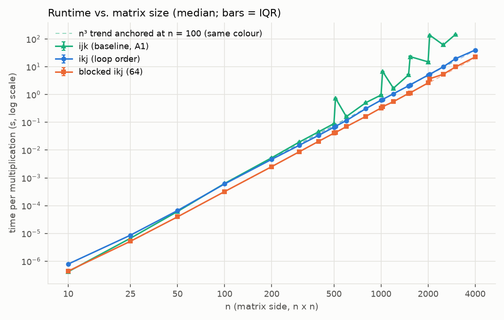
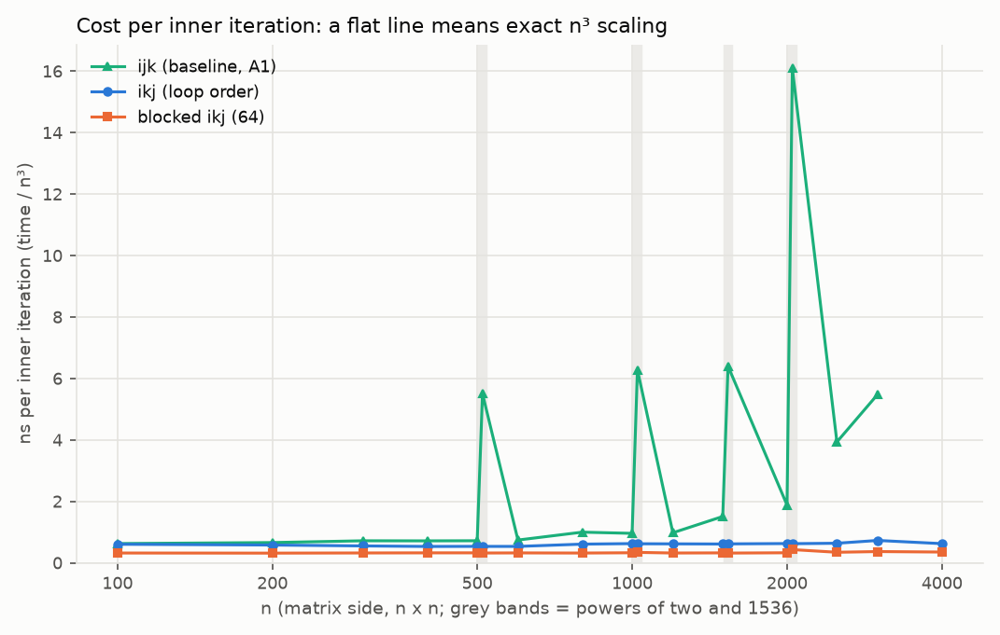
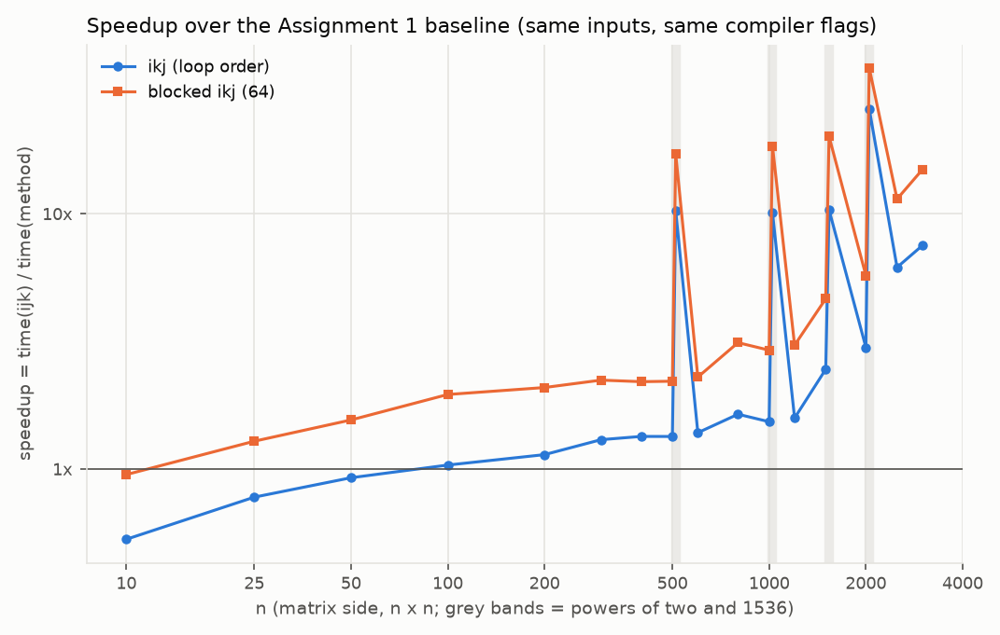
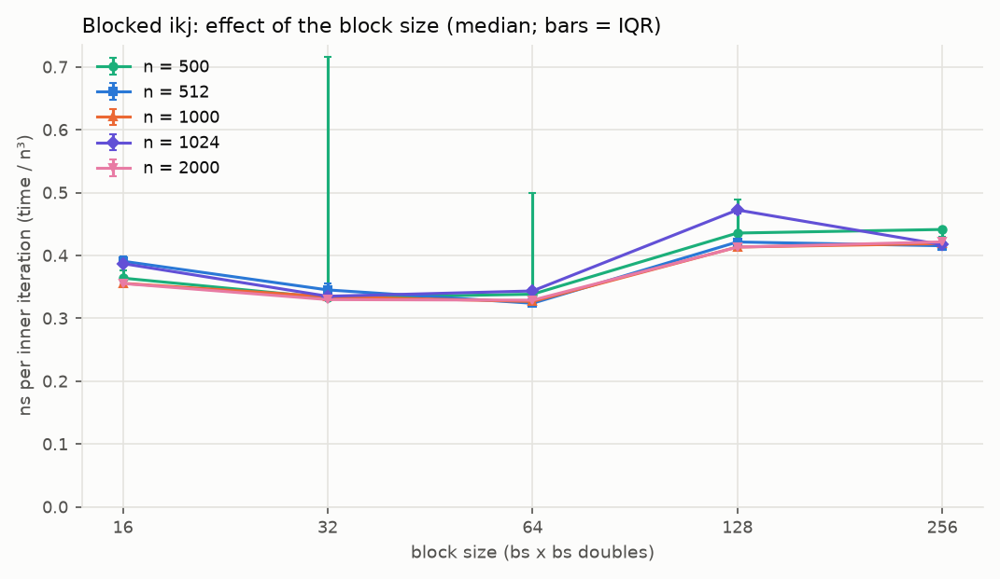
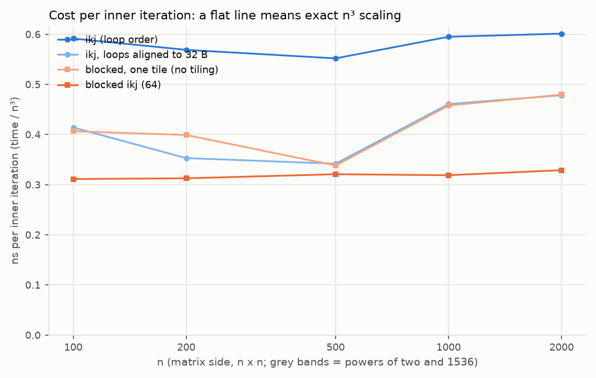
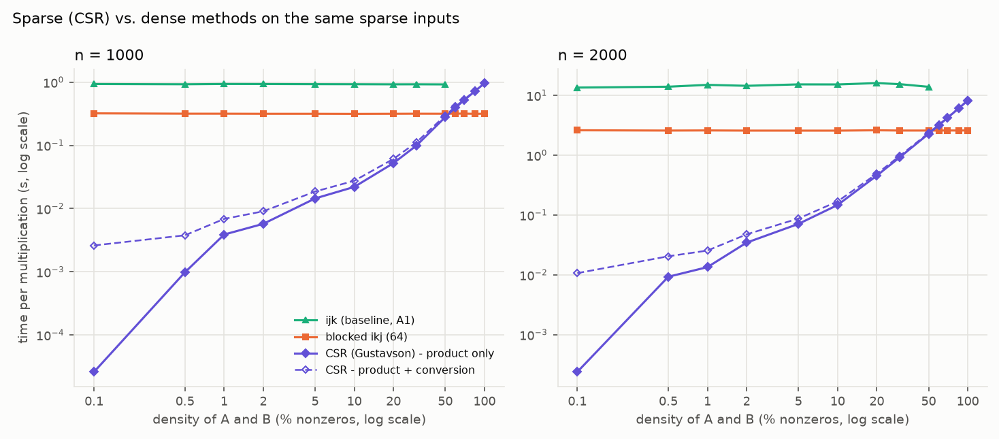
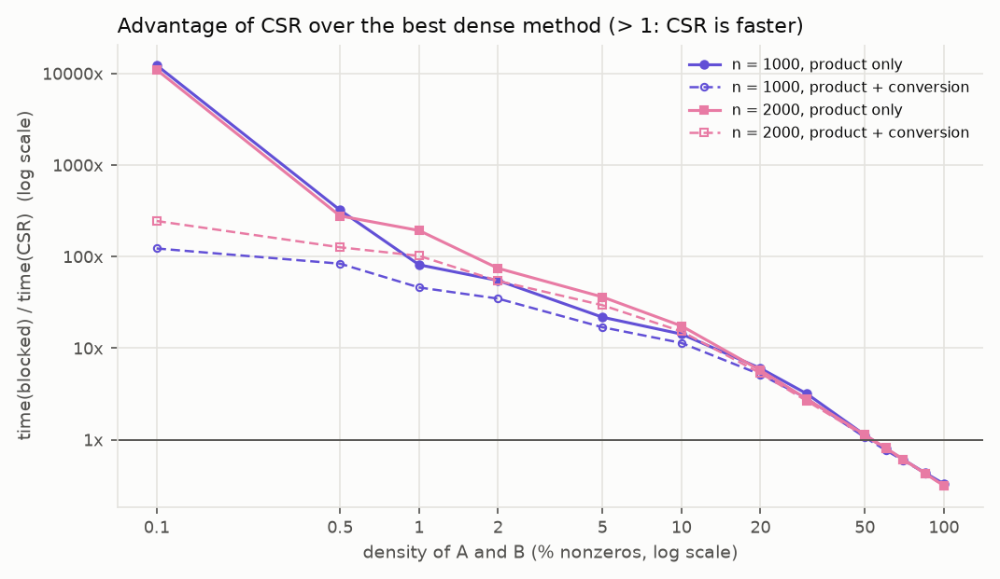
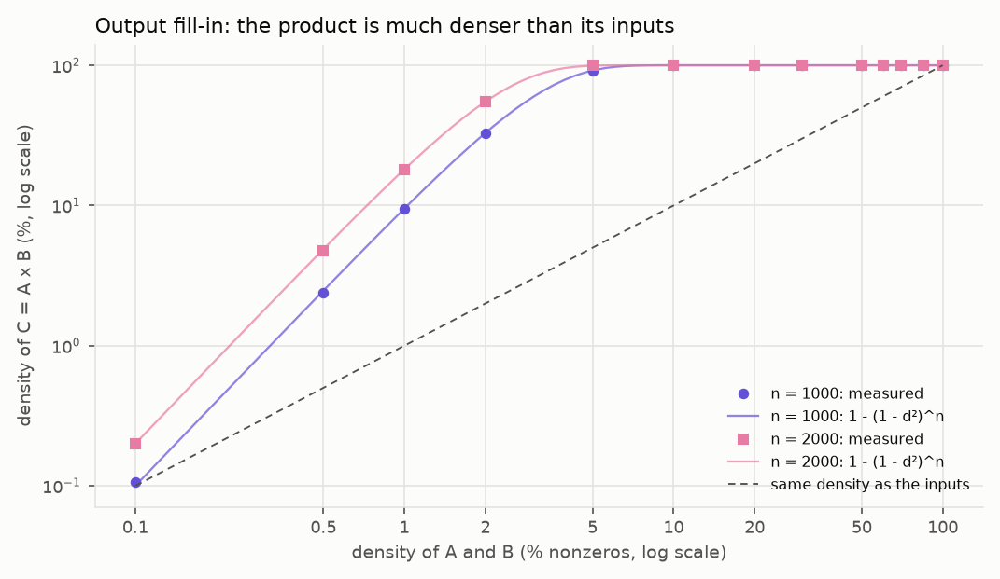
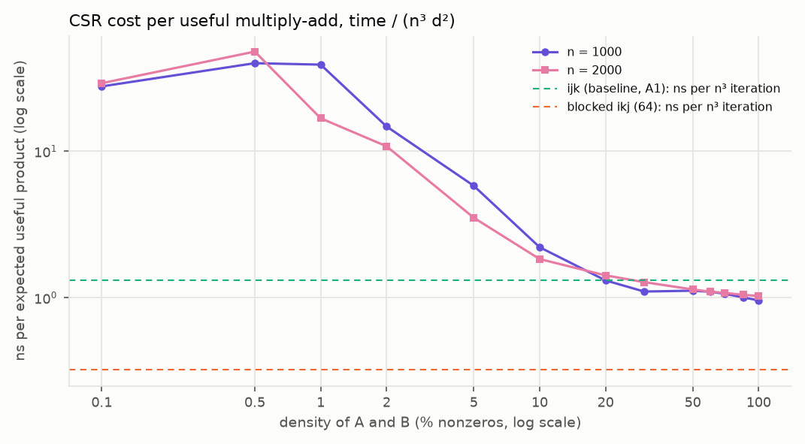
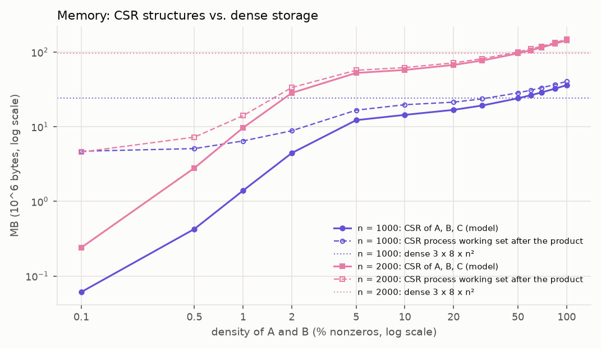

# How much do loop reordering and cache blocking speed up matrix multiplication, and when does a sparse (CSR) representation pay off?

<div class="meta" markdown="1">
**Big Data - Individual Assignment 2: Optimised matrix multiplication approaches and sparse matrices**<br>
Grado en Ciencia e Ingeniería de Datos, Universidad de Las Palmas de Gran Canaria, 2026-2027<br>
**Author:** Guillermo Oltra Rodriguez - **Date:** October 2026<br>
**Materials:** GitHub repository <https://github.com/shisher06/bigdata-matmul-assignment2> (code, input configurations, raw measurements, analysis scripts; see `README.md` and Section 8). It reuses the validated C implementation and the input files of Assignment 1.
</div>

> **Abstract.** This study continues Assignment 1 (naive `i-j-k` matrix multiplication in C, Python and
> Java) with two questions. (A) How much do two dense optimisations, loop reordering (`i-k-j`) and cache
> blocking (64 x 64 tiles), speed up the Assignment 1 C kernel, and do they remove the cache effects
> found there? (B) For which densities is an own sparse CSR x CSR multiplication (Gustavson's algorithm)
> faster than the best dense method? All methods are in C (gcc 11.2 `-O2`, one thread), use the same
> input files (Part A reuses the Assignment 1 files), give exactly the same result bit for bit, and
> were measured on one laptop (Ryzen 7 4800H, Windows 11) with a new process per run and 5
> repetitions. Loop reordering removed the slowdowns at n = 512, 1024, 1536 and 2048 and the growth
> faster than n³ (log-log slope 3.05 instead of 3.74); blocking was the fastest dense method (about
> 0.33 ns per inner iteration up to n = 4000; 5.7 times faster than the baseline at n = 2000 and 15
> times at n = 3000). A control experiment showed that part of the advantage of blocking at small n
> comes from where the compiler placed the inner loop, and that tiling itself gives about 1.45 times
> over `i-k-j` for n >= 1000. CSR was faster than blocking up to 50 % nonzeros (from about 10 000
> times at 0.1 % to 1.13 times at 50 %) and slower above a crossover of about 53 % for n = 1000 and
> 2000, in agreement with a simple work model; the conversion to CSR (up to 100 times the product time
> at 0.1 %) and the fill-in of the result (almost dense from 5 %) reduce the advantage. The conclusions
> only apply to these implementations, uniformly random sparse inputs and this machine.

## 1. Introduction

In Assignment 1 I compared the basic triple-loop multiplication (`i-j-k`) in Python, Java and C. The
main open point of that study was the memory hierarchy: in C the time grew faster than n³ (log-log
slopes of 3.2 to 3.6), it jumped when matrix `B` stopped fitting in the 4 MiB L3 cache (between
n = 600 and 800), and at n = 512, 1024 and 1536 it was 6 to 7 times slower than at nearby sizes. I
explained these effects by the column-wise reading of `B` in the inner loop, but I could not test the
explanation. This assignment tests it by changing *only* the way the loops walk through memory, and
then looks at a different way to save work: not multiplying zeros at all.

**Research questions.**

- **Part A (dense optimisation).** How much do two memory-oriented optimisations, *loop reordering*
  (`i-k-j`) and *cache blocking* (tiled `i-k-j`), reduce the runtime of the Assignment 1 C triple
  loop, and do they remove the effects of the memory hierarchy found there?
- **Part B (sparse matrices).** For which tested densities and sizes is a sparse multiplication
  (CSR x CSR, Gustavson's algorithm) faster than the best dense method on the same matrices, and how
  much of that advantage is lost to the conversion to CSR and to the fill-in of the result?

- **What changes:** the method (`ijk`, `ikj`, `blocked`, `csr`), the size `n` and, in Part B, the
  density (percentage of nonzero entries) of the inputs.
- **What is measured:** time per multiplication (median and IQR of 5 repetitions), peak memory of the
  process and, in Part B, the conversion time, the memory of the CSR structures and the number of
  nonzeros of the inputs and of the result.
- **What stays the same:** the language (C), the compiler and its flags, the numeric type (`float64`),
  the timing boundary, the machine and, within each comparison, the input files.

**Hypotheses** (written before the main campaigns, from the Assignment 1 results and a short
preliminary run at n = 512 and 1000):

- **H1.** `ikj` will be faster than `ijk` for large `n` and will remove the slowdowns at powers of two,
  because its inner loop reads `B` and `C` row by row instead of reading `B` by columns.
- **H2.** `blocked` will be faster than `ikj` once the matrices no longer fit in the cache (n of the
  order of 700 or more), and close to it for small `n`. With blocking the time should follow n³ closely
  (constant cost per iteration).
- **H3.** The three dense methods will use the same memory (3 x 8 x n² bytes plus the C runtime), since
  they only change the order of the loops.
- **H4.** CSR will be much faster than the dense methods at low densities, because its work is
  proportional to the number of useful products (about n³d² for density d) instead of n³; the advantage
  will shrink as the density grows, and above some density (expected between 10 % and 50 %) dense
  `blocked` will be faster, because each sparse product costs more than a dense one (indirect indices,
  scattered accesses to the accumulator).
- **H5.** The result `C` will be much denser than `A` and `B` (fill-in), so the output part of the
  CSR algorithm and its memory will grow faster than the density of the inputs.

## 2. Background

**The three dense loop orders.** `C = A x B` needs n³ multiply-adds whatever the loop order [1]. The
order only changes *which memory positions are read one after another*. Matrices are stored row by
row (row-major), and the CPU reads memory in 64-byte cache lines (8 doubles) [2]:

- `i-j-k` (Assignment 1): the inner loop runs over `k` and reads `B[k][j]`, a **column** of `B`; two
  consecutive reads are 8n bytes apart, so each one uses a different cache line and only 8 of its 64
  bytes. When `B` (8n² bytes) is larger than the cache, these lines must come again from main memory
  for every row of `C`.
- `i-k-j` (loop reordering): the inner loop runs over `j` and computes `C[i][j] += a * B[k][j]` with a
  fixed `a = A[i][k]`. Both `B` and `C` are read along a **row**, so every cache line brings 8 useful
  values, and the hardware prefetcher can predict the next ones. The amount of arithmetic is the same.
- **Cache blocking (tiling)**: the `i-k-j` loops are run on square tiles of bs x bs elements, so that a
  tile of `B` and the corresponding part of the rows of `C` are reused many times while they are still
  in a fast cache, instead of streaming the whole of `B` (8n² bytes) from memory for every row of `C`
  [1], [3]. Lam, Rothberg and Wolf showed that the best block size depends on the cache size and on
  conflicts between addresses, and that the block should usually be smaller than the cache [3].

**Cache conflicts at powers of two.** In a set-associative cache each address can only go to a few
places ("ways") of one set, chosen by some bits of the address [2]. If consecutive accesses are 8n
bytes apart and 8n is a multiple of 4096 (n = 512, 1024, 1536, 2048), they all fall in the same few
sets and evict each other, so the cache behaves as if it were much smaller. This is the explanation of
the Assignment 1 slowdowns; in `ijk` it affects the column walk of `B`, which `ikj` and `blocked` no
longer do.

**Sparse matrices and CSR.** A matrix is *sparse* when most of its entries are zero. Here the **density**
`d` is the percentage of nonzero entries and the **sparsity** is `100 - d`. The *Compressed Sparse Row*
(CSR) format stores, row by row, only the nonzero values (`val`), their column indices (`col`) and, for
each row, where it starts (`row_ptr`) [4]. With 8-byte values, 4-byte column indices and 8-byte row
pointers, a matrix takes `12 nnz + 8(n + 1)` bytes instead of `8n²`.

**Gustavson's algorithm** [5] computes `C = A x B` row by row: row `i` of `C` is the sum of the rows `k`
of `B` multiplied by the nonzeros `A[i][k]`. Only nonzero pairs are multiplied, so the work is
proportional to the number of useful products. If the nonzeros are placed independently with
probability `d`, the expected number of useful products is n³d², and an entry of `C` is nonzero with
probability `1 - (1 - d²)^n` (it is zero only if none of the n products is nonzero). For example with
n = 1000 and d = 5 %, `C` is about 92 % nonzero although the inputs are 95 % zeros: the output becomes
dense very quickly.

**Hardware.** The Ryzen 7 4800H (Zen 2) has, per core, 32 KiB of L1 data cache (8-way) and 512 KiB of
L2 (8-way), and each group of 4 cores shares 4 MiB of L3 (16-way) [6]. A 64 x 64 tile of doubles takes
32 KiB, so three tiles (of `A`, `B` and `C`) fit in L2.

## 3. Methodology

### 3.1 What is reused from Assignment 1

The Assignment 1 materials (repository <https://github.com/shisher06/bigdata-matmul-assignment1>, commit `e947d18`, folder
`practica1/`) were copied into `practica2/` and extended, so that this submission is self-contained:

| Reused | How |
|:---|:---|
| C worker `src/c/matmul.c` | The kernel `matmul_ijk` is **unchanged** and is the baseline. Timer, file reading, warm-up, batching, checksum and memory reading are the same code. New: `--method`, `--block`, the two optimised kernels and the CSR code. |
| Input files and generator | `data/A_n.bin`, `data/B_n.bin` are **the same files** (same generator, seed 2026, same SHA-256, checked by a test). New: a sparse generator. |
| Verifier and tolerances | `verify.py` without changes (NumPy, `rtol = 1e-9`, `atol = 1e-12`). |
| Benchmark runner | Same protocol (Section 3.5); it compares methods instead of languages. |
| Build, environment, analysis, PDF | Same scripts, adapted (only C `-O2`; new tables and plots). |

Only C is used. The Assignment 1 study showed that the memory effects that the optimisations target
are clearly visible in C, while in Python the interpreter cost (about 70 ns per iteration) hides them.

### 3.2 Implementations

All four kernels are in the same binary, compiled with the same flags, and are selected with
`--method`. No matrix library is used inside the timed code.

```c
/* ijk - baseline, Assignment 1 (unchanged)      */  /* ikj - loop reordering                    */
for (i = 0; i < n; i++)                               for (i = 0; i < n; i++)
  for (j = 0; j < n; j++)                               for (k = 0; k < n; k++) {
    for (k = 0; k < n; k++)                               a = A[i][k];
      C[i][j] += A[i][k] * B[k][j];                       for (j = 0; j < n; j++)
                                                            C[i][j] += a * B[k][j];
                                                        }
/* blocked - ikj on bs x bs tiles (bs = 64) */
for (ii = 0; ii < n; ii += bs)
  for (kk = 0; kk < n; kk += bs)
    for (jj = 0; jj < n; jj += bs)
      for (i = ii; i < min(ii+bs, n); i++)
        for (k = kk; k < min(kk+bs, n); k++) {
          a = A[i][k];
          for (j = jj; j < min(jj+bs, n); j++) C[i][j] += a * B[k][j];
        }
```

The CSR kernel (`matmul_csr`) follows Gustavson's algorithm [5]. For each row `i` it walks the nonzeros
`A[i][k]` (in increasing `k`) and, for each, the nonzeros `B[k][j]`, adding `A[i][k] * B[k][j]` to a
dense accumulator row `acc[j]`. An array `mark[j]` records whether column `j` already appeared in row
`i` (then `acc[j]` is valid; otherwise it is set to 0.0 and `j` is added to a list). At the end of the
row the columns are sorted (with `qsort` if there are few, or by scanning `mark` if there are more than
n/8) and copied into the CSR arrays of `C`, which grow by doubling. The conversion from the dense input
to CSR (`csr_from_dense`) counts the nonzeros and then fills the three arrays.

| Method | Storage | Work | What changes compared with `ijk` |
|:---|:---|:---|:---|
| `ijk` | dense, 8n² B per matrix | n³ | - |
| `ikj` | dense | n³ | loop order: inner loop along rows of `B` and `C` |
| `blocked` | dense | n³ | `ikj` on 64 x 64 tiles (block chosen in Section 4.3) |
| `csr` | CSR, 12 nnz + 8(n + 1) B per matrix | about n³d² products + O(n) per row | only nonzero products; indirect indexing |

**Same result, bit for bit.** In all four kernels each `C[i][j]` starts at 0.0 and receives the products
in increasing order of `k`, without FMA (`-ffp-contract=off`): in `blocked` the `k` tiles are visited
in increasing order, and in `csr` the skipped products are exact zeros, and adding `+0.0` does not
change a `double`. So all methods must produce **exactly the same bits** as the Assignment 1 baseline,
which gives a very strict correctness check (Section 3.7).

**No SIMD.** With gcc 11.2, `-O2` does not enable the automatic vectorisation (`gcc -Q --help=optimizers
-O2` lists `-ftree-loop-vectorize` as disabled; it is enabled at `-O3`) [7]. So the differences between
methods come from memory access and loop overhead, not from vector instructions, which are left for
Assignment 3.

### 3.3 Inputs

- **Part A** uses the Assignment 1 files `data/A_n.bin` and `data/B_n.bin` (values uniform in [0, 1),
  `float64`, row by row, CPython `random` with base seed 2026), plus the same generator for the new
  sizes. A test checks that the generator still reproduces the SHA-256 of the Assignment 1 manifest.
- **Part B** uses new files `data_sparse/A_<n>_d<pct>.bin`, written in the **same dense format** (zeros
  included) so that the dense and sparse methods read exactly the same logical matrices. For each cell,
  a uniform number `u` is drawn; if `u < d` the cell gets a value `1 - random()` in (0, 1], otherwise
  0. So the nonzeros are placed **uniformly and independently** (no structure), with the declared
  density on average. The seed of each matrix depends on n and d (rule in `README.md`), and
  `data_sparse/manifest.json` stores the seed, the real number of nonzeros and the SHA-256 of each file.
- **Densities:** 0.1, 0.5, 1, 2, 5, 10, 20, 30 and 50 % (sparsity 99.9 % to 50 %).

### 3.4 Environment

| Item | Value |
|:---|:---|
| Machine | Laptop, AMD Ryzen 7 4800H, 8 cores / 16 threads, 2.9 GHz (boost up to 4.2 GHz) |
| Caches [6] | L1d 32 KiB and L2 512 KiB per core; L3 2 x 4 MiB |
| Memory | 15.4 GiB |
| Operating system | Windows 11 Home (build 26300) |
| Power | Plugged in, default power plan |
| C | gcc 11.2.0 (MinGW-w64), `-std=c11 -O2 -ffp-contract=off`, the four methods in one binary |
| Threads | One computing thread; `OMP/OPENBLAS/MKL_NUM_THREADS=1` in the measured processes |
| Python (runner, analysis) | CPython 3.11.9, NumPy 2.4.6 (only for checking), matplotlib 3.11.2, psutil 7.2.2 |

This information is saved automatically in `results/*/environment.md` and `build/build_info.json`.

### 3.5 Timer and measurement protocol (same as Assignment 1)

- **What the timer includes:** only the kernel call: allocating `C`, initialising it (or building the
  CSR of `C`) and running the loops. Reading the files, the warm-up, the checksum and saving the result
  are outside. Timer: `QueryPerformanceCounter` (monotonic). The result is always used afterwards (a
  checksum of all elements), so the compiler cannot skip the computation.
- **Conversion (Part B):** for `csr`, the conversion of `A` and `B` from the dense input to CSR is
  timed **separately** (once per process). Results are given both for the product alone and for
  product + conversion; the output stays in CSR (it is not converted back to dense inside any timer).
- **A new process for each repetition** and method; **interleaved order** (for each case and
  repetition all methods run, and the order rotates in each repetition).
- **5 repetitions** per configuration (3 if the first one takes more than 120 s).
- **Short tasks:** if one multiplication takes less than 100 ms, a batch is timed together and the
  time is divided by the batch size. For `csr` the batch size is always calibrated with one extra
  (discarded) run, because its cost is not cubic.
- **Warm-up:** one run on the 64 x 64 corner of the matrices, not included in the results.
- **Statistics:** median and inter-quartile range (IQR); all raw measurements are kept in `raw.csv`.

### 3.6 Memory metrics

- **Peak working set of the process** (the Assignment 1 metric): read by the runner with
  `GetProcessMemoryInfo` when the process ends. For `csr` it includes reading the dense input files,
  so it does not show the saving of CSR by itself.
- **Working set after the product** (new): the current working set of the process right after the
  timed region. In `csr` the dense inputs have already been freed, so it reflects the CSR structures
  plus the C runtime (about 4 MB).
- **Data-structure model**: exact bytes of the structures used by each method: 3 x 8n² for the dense
  methods, `12 nnz + 8(n + 1)` per matrix (A, B and C) for CSR.

### 3.7 Correctness

Before measuring, **24 automated tests** (`tests/`) were run with every method: small cases computed by
hand (1x1, 2x2, 3x3), identity and zero matrices, non-commutativity, exact integer results, comparison
with NumPy, **bit identity with the Assignment 1 Python kernel** (n = 40 and 67, which is not a
multiple of any block size; `blocked` is also tested with block 5), sparse inputs (0 %, 100 % and
random densities, with the nonzero counts), the CSR memory model, batching and invalid inputs; plus
tests of the input files (Assignment 1 hashes), the sparse generator and the verifier.

During each campaign, as in Assignment 1, in repetition 1 of each method and case the result is saved
after the timer and compared with NumPy's `A @ B` (`rtol = 1e-9`, `atol = 1e-12`; NumPy adds in a
different order, so differences around 1e-15 are expected). The SHA-256 of the result must be the same
for all methods, and in repetitions 2 to 5 the checksum must be equal to repetition 1.

### 3.8 Sizes and limits (decided before measuring)

- **Part A:** n = 10, 25, 50, 100, 200, 300, 400, 500, **512**, 600, 800, 1000, **1024**, 1200, 1500,
  **1536**, 2000, **2048**, 2500, 3000, 4000: the Assignment 1 sizes, the powers of two (and 1536) where
  Assignment 1 found slowdowns, and larger sizes to find the limits of each method.
- **Block size (separate experiment):** bs = 16, 32, 64, 128, 256 at n = 500, 512, 1000, 1024, 2000.
- **Part B:** n = 1000 and 2000 with the nine densities and the methods `csr`, `blocked` and `ijk`;
  n = 4000 with 0.1 % and 1 % (`csr` and `blocked`; `ijk` at n = 4000 is measured in Part A).
- **Limits (as in Assignment 1):** 300 s per process and 4096 MB per process. A run over a limit is
  recorded as a result with no time, and that method does not try larger cases.

### 3.9 Separate experiments

Three experiments are kept apart from the main comparisons (own folders, not mixed in the main tables):

- `02_A_extra_bloques`: the block-size sweep (Section 4.3), run first to choose the block.
- `05_B_extra_densidades_altas`: CSR and `blocked` at densities of 60, 70, 85 and 100 % (n = 1000 and
  2000). **It was added after the main Part B campaign**, because CSR was still faster at the highest
  declared density (50 %), so the crossover had not been found.
- `06_A_extra_alineacion`: a control experiment, also **added after the main Part A campaign**, to
  explain why `blocked` was faster than `ikj` even for small matrices (Section 4.4). It uses a second
  build of the same source with `-falign-loops=32`, and `blocked` with one single tile (block = 10^6,
  so it performs exactly the operations of `ikj` in the same order).

## 4. Results

Data: `results/01_A_densa/` (Part A: 307 runs, 306 correct and 1 timeout), `02_A_extra_bloques/`
(125 runs), `03_B_dispersa/` (270 runs), `04_B_dispersa_n4000/` (20 runs), `05_B_extra_densidades_altas/`
(80 runs) and `06_A_extra_alineacion/` (120 runs). Each folder has `raw.csv`, `summary.md` (complete
tables), `campaign.log`, `environment.md` and `plots/`. All campaigns were run on 27 Oct 2026 in one
session with the laptop plugged in; Part A took 41 minutes and Part B 26 minutes.

### 4.1 Correctness

- The 24 tests passed before every campaign.
- **All methods produced exactly the same result** (same SHA-256 of `C`) in every comparable case: the
  21 sizes of Part A, the 26 (n, density) cases of Part B and the cases of the separate experiments.
  So `ikj`, `blocked` and `csr` compute bit for bit the same numbers as the Assignment 1 baseline.
- Maximum relative error against NumPy: 8.3e-15 (tolerance 1e-9). In repetitions 2 to 5 the checksum
  was always equal to repetition 1.
- The generated code was checked (`gcc -S`): each of the four kernels contains one scalar
  multiplication (`mulsd`) and no vector (`mulpd`) or FMA instruction.

### 4.2 Part A: runtime of the three dense methods

<figure markdown="1">

<figcaption>Figure 1. Time per multiplication against n (log-log), median of 5 repetitions (3 for
ijk at n = 2048 and 3000); the bars (IQR) are mostly smaller than the markers.</figcaption>
</figure>

| n | `ijk` (baseline) | `ikj` | `blocked` (64) | speedup `ikj` | speedup `blocked` |
|---:|---:|---:|---:|---:|---:|
| 10 | 0.418 µs | 0.788 µs | 0.439 µs | 0.53x | 0.95x |
| 50 | 61.5 µs | 66.5 µs | 39.5 µs | 0.92x | 1.56x |
| 100 | 627 µs | 605 µs | 320 µs | 1.04x | 1.96x |
| 200 | 5.28 ms | 4.64 ms | 2.53 ms | 1.14x | 2.09x |
| 500 | 89.9 ms | 67.0 ms | 40.7 ms | 1.34x | 2.21x |
| **512** | **739 ms** | 71.9 ms | 43.0 ms | **10.3x** | **17.2x** |
| 800 | 511 ms | 312 ms | 164 ms | 1.64x | 3.13x |
| 1000 | 960 ms | 627 ms | 329 ms | 1.53x | 2.92x |
| **1024** | **6.75 s** | 667 ms | 366 ms | **10.1x** | **18.4x** |
| 1500 | 5.09 s | 2.07 s | 1.10 s | 2.46x | 4.65x |
| **1536** | **23.2 s** | 2.24 s | 1.15 s | **10.4x** | **20.1x** |
| 2000 | 15.1 s | 5.02 s | 2.63 s | 2.99x | 5.73x |
| **2048** | **138 s** | 5.36 s | 3.70 s | **25.8x** | **37.3x** |
| 2500 | 61.5 s | 9.97 s | 5.38 s | 6.17x | 11.4x |
| 3000 | 148 s | 19.7 s | 9.92 s | 7.52x | 14.9x |
| 4000 | timeout (> 300 s) | 40.0 s | 22.5 s | - | - |

Speedup = median time of `ijk` / median time of the method. Complete table (21 sizes, with Q1, Q3 and
IQR): `results/01_A_densa/summary.md`. Variability was low: IQR below 2 % of the median in 32 of the
62 configurations and below 5 % in 54; the largest was 11 % (`ikj`, n = 3000).

<figure markdown="1">

<figcaption>Figure 2. Time divided by n³ (ns per inner iteration). A flat line means that the time
grows exactly as n³. Grey bands: n = 512, 1024, 1536 and 2048.</figcaption>
</figure>

- **Baseline `ijk`.** It reproduces the Assignment 1 behaviour: about 0.42 to 0.74 ns per iteration up
  to n = 600, about 1 ns between 800 and 1200, and then a fast increase (1.5 ns at 1500, 1.9 at 2000,
  3.9 at 2500, 5.5 at 3000), with peaks of 5.5 to 6.4 ns at 512, 1024 and 1536 and **16.1 ns at 2048**.
  The log-log slope for n >= 100 is **3.74** (3.58 without the powers of two). At n = 4000 the first run
  passed the 300 s limit (recorded as a timeout), so its largest size within the limits is 3000.
- **`ikj`.** Between 0.53 and 0.73 ns per iteration from n = 25 to 4000, **without any peak at the
  powers of two**. Slope **3.05**.
- **`blocked`.** Between 0.32 and 0.37 ns per iteration from n = 25 to 4000 (0.43 at n = 2048), about
  1.9 times less than `ikj` at every size. Slope **3.04**.
- **Small matrices.** At n = 10 `ikj` is 1.9 times *slower* than `ijk`, and at n = 25 to 50 it is
  still slightly slower; from n = 100 it is faster.
- **Comparison with Assignment 1.** The `ijk` medians are within -5 % and +11 % of the Assignment 1
  values up to n = 1500 (same code, flags, inputs and machine, measured 13 days later), but at n = 2000 the
  new median is 15.1 s against 10.8 s (1.39 times).

<figure markdown="1">

<figcaption>Figure 3. Speedup of the optimised methods over the Assignment 1 baseline.</figcaption>
</figure>

### 4.3 Separate experiment: block size

| n | block 16 | block 32 | block 64 | block 128 | block 256 |
|---:|---:|---:|---:|---:|---:|
| 500 | 0.364 | **0.333** | 0.338 | 0.436 | 0.441 |
| 512 | 0.391 | 0.345 | **0.324** | 0.421 | 0.415 |
| 1000 | 0.356 | 0.334 | **0.327** | 0.413 | 0.419 |
| 1024 | 0.387 | **0.335** | 0.344 | 0.472 | 0.417 |
| 2000 | 0.355 | 0.330 | **0.329** | 0.413 | 0.422 |

ns per inner iteration (median of 5); best block in bold. Blocks of 32 and 64 are close (within 7 %),
16 is 8 to 21 % slower than the best and 128 or 256 are 24 to 41 % slower. The value 64 used in the main
campaign is the best or within 3 % of the best at every size. At n = 500 the first two repetitions of
blocks 32 and 64 were about twice as slow as the other three (the laptop was also being used at the
start of the session); the medians are not affected, and no measurement was removed.

<figure markdown="1">

<figcaption>Figure 4. Blocked i-k-j: cost per iteration against the block size.</figcaption>
</figure>

### 4.4 Separate experiment: why is `blocked` faster than `ikj` for small n?

For n <= 64 the `blocked` kernel uses one single tile and performs exactly the same operations as
`ikj`, in the same order, but it was 1.7 times faster at n = 50. The machine code of the two inner
loops is the same (7 instructions: load, multiply, add, store, increment, compare, jump), but in the
binary the `ikj` loop starts at address `...17f0` and **crosses a 64-byte boundary** (`...1800`),
while the `blocked` loop (`...19e0` to `...19fb`) lies inside one 32-byte block. To test whether this
code placement matters, two controls were measured with the full protocol:

| n | `ikj` | `ikj`, loops aligned to 32 B | `blocked`, one tile (no tiling) | `blocked` (64) |
|---:|---:|---:|---:|---:|
| 50 | 0.505 | 0.492 | 0.302 | 0.303 |
| 100 | 0.591 | 0.414 | 0.407 | 0.311 |
| 200 | 0.569 | 0.353 | 0.399 | 0.313 |
| 500 | 0.552 | 0.342 | 0.338 | 0.321 |
| 1000 | 0.595 | 0.461 | 0.458 | 0.319 |
| 2000 | 0.601 | 0.478 | 0.480 | 0.329 |

ns per inner iteration, median of 5 (`results/06_A_extra_alineacion/`). From n = 100, aligning the
`ikj` loop makes it as fast as `blocked` without tiling (difference below 3 % except n = 200), so most
of the gap between `ikj` and `blocked` for n <= 500 is a **code-placement effect**, not a cache effect.
The real effect of tiling is the difference between the last two columns: about 1.05 times at n = 500
and **1.44 to 1.46 times at n = 1000 and 2000**. At n = 50 the aligned `ikj` is still as slow as the
normal one; this case is not explained.

<figure markdown="1">

<figcaption>Figure 5. Separating the code-placement effect from the tiling effect.</figcaption>
</figure>

### 4.5 Part A: memory

The peak working set is the same for the three dense methods (for example 28.5 MB at n = 1000,
100.5 MB at n = 2000 and 388.5 MB at n = 4000) and follows the storage model 3 x 8 x n² (24, 96 and
384 MB) plus about 4.5 MB of the C runtime. The only differences (up to 2.8 MB, at n = 512 and 600) come
from the batches used for short runs. Largest peak: 388.5 MB, far from the 4096 MB budget.

### 4.6 Part B: sparse inputs, CSR against the dense methods

<figure markdown="1">

<figcaption>Figure 6. Time per multiplication against the density of A and B, with the same input
files for all methods (main campaign and the high-density experiment). Dashed: CSR product plus the
conversion of A and B to CSR.</figcaption>
</figure>

| n | density | nnz(A) | density of C | CSR product | conversion | `blocked` | `ijk` | `blocked` / CSR | `blocked` / (CSR + conv.) |
|---:|---:|---:|---:|---:|---:|---:|---:|---:|---:|
| 1000 | 0.1 % | 969 | 0.11 % | 26.1 µs | 2.58 ms | 321 ms | 934 ms | 12 300x | 123x |
| 1000 | 1 % | 9 964 | 9.4 % | 3.88 ms | 2.98 ms | 316 ms | 935 ms | 81x | 46x |
| 1000 | 5 % | 49 850 | 91.8 % | 14.5 ms | 4.15 ms | 315 ms | 929 ms | 22x | 17x |
| 1000 | 20 % | 199 650 | 100 % | 52.3 ms | 8.73 ms | 315 ms | 923 ms | 6.0x | 5.2x |
| 1000 | 50 % | 500 386 | 100 % | 280 ms | 17.3 ms | 316 ms | 921 ms | 1.13x | 1.06x |
| 1000 | 60 % | 600 284 | 100 % | 396 ms | 16.0 ms | 317 ms | - | 0.80x | 0.77x |
| 1000 | 100 % | 1 000 000 | 100 % | 960 ms | 5.63 ms | 316 ms | - | 0.33x | 0.33x |
| 2000 | 0.1 % | 4 035 | 0.20 % | 238 µs | 10.4 ms | 2.61 s | 13.5 s | 11 000x | 245x |
| 2000 | 1 % | 39 982 | 18.1 % | 13.4 ms | 12.0 ms | 2.59 s | 15.0 s | 193x | 102x |
| 2000 | 5 % | 200 753 | 99.3 % | 70.9 ms | 16.3 ms | 2.57 s | 15.3 s | 36x | 30x |
| 2000 | 20 % | 800 612 | 100 % | 456 ms | 34.1 ms | 2.61 s | 16.1 s | 5.7x | 5.3x |
| 2000 | 50 % | 1 999 895 | 100 % | 2.28 s | 69.5 ms | 2.58 s | 13.9 s | 1.13x | 1.10x |
| 2000 | 60 % | 2 399 891 | 100 % | 3.17 s | 64.3 ms | 2.58 s | - | 0.82x | 0.80x |
| 2000 | 100 % | 4 000 000 | 100 % | 8.23 s | 22.4 ms | 2.59 s | - | 0.31x | 0.31x |
| 4000 | 0.1 % | 16 029 | 0.40 % | 2.14 ms | 40.8 ms | 21.9 s | - | 10 200x | 509x |
| 4000 | 1 % | 159 986 | 32.9 % | 91.8 ms | 46.3 ms | 21.6 s | - | 236x | 157x |

Medians of 5 repetitions; all densities in `results/03_B_dispersa/summary.md`,
`results/05_B_extra_densidades_altas/summary.md` and `results/04_B_dispersa_n4000/summary.md`.

- **CSR is faster than the best dense method at every density up to 50 %**, by more than 10 000 times
  at 0.1 % (product only) and by 1.13 times at 50 %. It is slower from 60 % on, and 3.0 to 3.2 times
  slower at 100 %. Interpolating in log-log scale, the crossover is at **53.3 % (n = 1000) and 53.6 %
  (n = 2000)** for the product alone, and at 51.8 % and 52.8 % including the conversion.
- **The dense methods do not depend on the density**: `blocked` takes 314 to 321 ms (n = 1000) and
  2.57 to 2.61 s (n = 2000) at every density, the same as with the dense inputs of Part A.
- **Conversion.** It takes 2.6 to 17 ms at n = 1000 and 10 to 70 ms at n = 2000. At 0.1 % it is 100
  times longer than the CSR product, so including it reduces the advantage from about 12 000x to
  123x (n = 1000) and 245x (n = 2000). It is largest at 50 to 60 % and *decreases* again towards 100 %
  (at n = 2000: 10.4 ms at 0.1 %, 69.5 ms at 50 %, 22.4 ms at 100 %).
- **Larger size.** At n = 4000 and 0.1 % density, CSR needs 2.1 ms (43 ms with the conversion)
  against 21.9 s for `blocked`.

<figure markdown="1">

<figcaption>Figure 7. Time of blocked divided by time of CSR (above 1: CSR is faster).</figcaption>
</figure>

### 4.7 Part B: fill-in of the result and cost per product

<figure markdown="1">

<figcaption>Figure 8. Density of C = A x B against the density of the inputs; lines: the model
1 - (1 - d²)^n for independent uniform nonzeros.</figcaption>
</figure>

The measured density of `C` agrees with the model 1 - (1 - d²)^n at every point (for example 9.45 %
measured and expected at n = 1000, d = 1 %; 55.0 % at n = 2000, d = 2 %). With inputs that are 99 %
zeros, `C` is already 9.4 % (n = 1000) or 18.1 % (n = 2000) nonzero, and from d = 5 % it is almost
completely dense (91.8 % and 99.3 %).

<figure markdown="1">

<figcaption>Figure 9. CSR time divided by the expected number of useful products n³d² (d = real
density of the inputs), compared with the cost per iteration of the dense methods.</figcaption>
</figure>

The CSR cost per useful product is 28 to 48 ns at densities of 0.1 and 0.5 %, falls quickly between 1 %
and 20 %, and stays at **1.0 to 1.3 ns from 30 % to 100 %** (1.0 to 1.14 ns from 50 %), about 3 to 3.5
times the 0.33 ns per iteration of `blocked`.

### 4.8 Part B: memory

<figure markdown="1">

<figcaption>Figure 10. Memory of the CSR structures of A, B and C (model, exact bytes) and working set
of the CSR process right after the product, against the dense storage 3 x 8n².</figcaption>
</figure>

| n | density | CSR structures (A + B + C) | CSR working set after product | CSR peak | dense structures | dense peak |
|---:|---:|---:|---:|---:|---:|---:|
| 1000 | 0.1 % | 0.06 MB | 4.7 MB | 20.4 MB | 24 MB | 28.5 MB |
| 1000 | 5 % | 12.3 MB | 16.7 MB | 34.4 MB | 24 MB | 28.5 MB |
| 1000 | 50 % | 24.0 MB | 28.4 MB | 36.5 MB | 24 MB | 28.5 MB |
| 2000 | 0.1 % | 0.24 MB | 4.6 MB | 68.5 MB | 96 MB | 100.5 MB |
| 2000 | 5 % | 52.6 MB | 57.0 MB | 121.3 MB | 96 MB | 100.5 MB |
| 2000 | 50 % | 96.0 MB | 100.4 MB | 132.5 MB | 96 MB | 100.5 MB |
| 2000 | 100 % | 144 MB | 148 MB | 180.5 MB | 96 MB | 100.5 MB |
| 4000 | 0.1 % | 1.2 MB | 6.1 MB | 260.8 MB | 384 MB | 388.5 MB |

The CSR structures are hundreds of times smaller than the dense ones at 0.1 %, but already half the
dense size at 5 % (because `C` is almost full), equal at 50 % and 1.5 times larger at 100 %. The working
set after the product follows the structures plus about 4.4 MB of the runtime. From 5 % on, the peak
of the CSR process is similar to or higher than the dense one (for example 121 MB against 100.5 MB at
n = 2000, 5 %), because it includes reading the two dense input files and building the CSR copies.

### 4.9 Limits

| Method | Largest size within the limits | Largest size attempted | Failures |
|:---|---:|---:|:---|
| `ijk` | 3000 (148 s) | 4000 | timeout (> 300 s) at n = 4000 |
| `ikj` | 4000 (40.0 s) | 4000 | none |
| `blocked` | 4000 (22.5 s) | 4000 | none |
| `csr` (Part B) | 4000 at 0.1 % and 1 % | 4000 | none |

No memory failure happened (largest peak 388.5 MB against 4096 MB). `ikj`, `blocked` and `csr` could
run larger sizes, but 4000 was the largest declared size; at n = 4000 each dense input file already
takes 128 MB.

## 5. Discussion

### 5.1 Loop order: the column walk of B was the cause of the Assignment 1 anomalies (H1 confirmed)

Changing only the order of the loops, with the same operations and the same result bit for bit,
removes the two memory effects of Assignment 1. In `ijk` the inner loop reads `B` by columns, 8n
bytes apart. When `B` (8n² bytes) no longer fits in the 4 MiB L3 (n of about 720), each read goes to a
new cache line from main memory, which explains the jump of `ijk` from 0.74 ns (n = 600) to 1.0 ns
(n = 800) and its later growth to 5.5 ns at n = 3000. At n = 512, 1024, 1536 and 2048 the stride is a
multiple of 4096 bytes and all the elements of a column fall in the same cache sets, so they evict each
other (Section 2): the cost per iteration rises to 5.5 to 16 ns. In `ikj` the inner loop reads rows,
so each 64-byte line gives 8 useful values and the stride never matters: the cost stays at 0.53 to
0.73 ns at every size, including the powers of two, and the slope falls from 3.74 to 3.05. This
supports, with a controlled experiment, the explanation that Assignment 1 could only propose: the
super-cubic growth was a memory-access effect, not a property of the algorithm. The gain grows with n,
from 1.0 to 1.6 times up to n = 1200 (except 512 and 1024) to 7.5 times at n = 3000 and 10 to 26 times at the powers of two.

For n <= 50 `ikj` is slower than `ijk`. A plausible reason is that each `(i, k)` pair starts a new inner
loop of only n iterations, and for very short loops the loop setup and the final branch weigh more than
in `ijk`, whose inner loop accumulates into a register; this was not measured directly.

### 5.2 Cache blocking: a real but smaller gain than it seemed (H2 partly confirmed)

`blocked` keeps a constant cost of about 0.32 to 0.37 ns per iteration from n = 25 to 4000 (slope 3.04),
so it does what H2 predicted for large n. However, Part A alone would overestimate the effect of
tiling: `blocked` is 1.9 times faster than `ikj` even at n = 50, where everything fits in L1 and a single
tile is used. The control experiment (Section 4.4) shows that this part of the gap comes from **where
the compiler placed the inner loop in memory**: with the loop aligned, `ikj` runs as fast as `blocked`
without tiling for n >= 100. A possible explanation is that a small loop that crosses a 64-byte
boundary needs two fetches of instructions per iteration instead of one; the evidence (addresses and the
effect of `-falign-loops=32`) fits this, but I did not measure the processor front end, so it remains
an interpretation. The case n = 50 is not explained by alignment.

With this effect removed, **tiling itself gives about 1.45 times at n = 1000 and 2000 and almost nothing
at n <= 500**. This matches the cache sizes: for n <= 500, `B` (at most 2 MB) still fits in the 4 MiB
L3, so `ikj` already reuses it from cache; from n = 1000 (`B` = 8 MB), `ikj` must read `B` again from
main memory for every row of `C`, while `blocked` reuses each 32 KiB tile of `B` for 64 rows. The block
size results agree with Lam et al. [3]: tiles of 32 x 32 or 64 x 64 (8 or 32 KiB, three of them fit in
L2) are best, 128 and 256 (128 KiB and 512 KiB per tile) are 24 to 41 % slower, and 16 x 16 tiles lose some
time in the overhead of very short loops. The small rise of `blocked` at n = 2048 (0.43 ns) is probably
again a conflict effect: the rows of a tile of `B` are 16 KiB apart, a multiple of the 4 KiB that
separates addresses mapped to the same L1 set, so the tile does not fit in L1 as well as at other
sizes [3]. Part of the measured speedups of Section 4.2 is therefore code placement; the conclusions
about the memory effects (Section 5.1) do not depend on it, because `ikj` is slower than `blocked` and
still removes all the anomalies.

### 5.3 The baseline at large n is less stable than the other methods

At n = 2000 `ijk` took 15.1 s here and 10.8 s in Assignment 1, and on the sparse inputs of Part B (the
same kernel, which does not depend on the values) it varied between 13.5 and 16.1 s depending on the
input files. Assignment 1 already reported that the cost of `ijk` above n = 1250 varied without a clear
pattern. All the runs here were correct and the IQR at n = 2000 was 5.5 %, so this is not a
measurement error but a real sensitivity of the column walk to things that change between processes,
probably where the operating system places the physical pages of `B`. `ikj` and `blocked` do not show
this behaviour (IQR at n = 2000: 1.3 % and 0.4 %). It also means that the speedups at n >= 1500 have an
uncertainty of about +-20 % coming from the baseline.

### 5.4 Memory of the dense methods (H3 confirmed)

The three dense methods have the same peak memory, equal to 3 x 8 n² plus the C runtime, because they
use the same arrays and only change the order of the loops. Optimising the access order did not cost
memory.

### 5.5 Sparse multiplication: where CSR helps and where it does not (H4 partly rejected)

H4 predicted that CSR would win at low densities and lose somewhere between 10 % and 50 %. The first
part was confirmed, but the crossover is much higher than expected: **about 53 % nonzeros for both
n = 1000 and n = 2000**. The cost model of Section 2 explains why. CSR does about n³d² useful products
and the dense method does n³ iterations, so CSR is faster when

    c_csr x n³ d² < c_dense x n³,   that is   d < sqrt(c_dense / c_csr).

With the measured costs at high density, c_csr = 1.0 to 1.14 ns (Figure 9) and c_dense = 0.33 ns
(`blocked`), the predicted crossover is sqrt(0.33 / 1.07) = 0.56, very close to the measured 53 %. Both
terms grow as n³, so the crossover does not depend on n, as observed. My hypothesis underestimated how
fast the work falls: at 10 % density CSR does only 1 % of the dense products, so even a cost per
product three times higher is still a large gain. Each CSR product is about 3 times more expensive than
a dense one because of the indirect accesses (`B->col[q]`, then `acc[j]`), the check of `mark[j]` and
the scattered writes to the accumulator, while the dense loop reads and writes consecutive positions.

**Where the advantage is reduced:**

- **Fixed costs at very low density.** At 0.1 % to 0.5 % the CSR cost per useful product is 28 to 48 ns:
  the work is so small (about 1000 products at n = 1000, d = 0.1 %) that the costs that do not depend on
  the products dominate (initialising `mark` and allocating the arrays of size n, the loop over the n
  rows, sorting or scanning each output row). The time is still tiny in absolute terms (26 µs).
- **Conversion.** Converting the dense input to CSR has to read all n² entries, so at low densities it
  costs far more than the product (2.6 ms against 26 µs at n = 1000, 0.1 %) and reduces the advantage
  about 100 times. In a real application the data would usually already be stored in a sparse format;
  with dense input files the conversion should be counted. Its time grows with the density up to 50 to
  60 % and then decreases to 100 %; this symmetric shape suggests that the main cost is the branch
  `if (value != 0)` being mispredicted, since with random positions it is least predictable at 50 %.
  This is an interpretation; branch mispredictions were not measured.
- **Fill-in of the output.** The density of `C` follows 1 - (1 - d²)^n: with n = 2000, inputs with 99 %
  zeros already give an 18 % dense product, and from 5 % the product is practically full. Then the
  output part of the algorithm (building the CSR of `C` with n² entries, sorting the columns) and its
  memory are as large as for a dense matrix or larger (H5 confirmed).

**Memory.** The CSR structures take 12 bytes per nonzero instead of 8 bytes per entry. With `C`
practically full, the total is about 12 (2d n²) + 12 n², which equals the dense 24 n² exactly at
d = 50 % (24.0 MB at n = 1000), as measured. So in these experiments CSR saves memory below 50 % and
uses more above it, and the saving is limited by the output: at 5 % the structures are already half the
dense size although the inputs are 95 % zeros.

**The percentage of zeros alone does not determine the result.** The same density gives very different
advantages for different n (at 1 %: 81 times at n = 1000 and 193 times at n = 2000, product only),
because the dense work grows as n³ and the CSR fixed costs as n or n². The output density depends on
n d², not only on d. Whether the conversion is counted changes the advantage by up to 100 times. And all
these results are for uniformly random positions: matrices with structure (banded, block or power-law
rows) produce different fill-in and different memory access patterns, which were not tested.

### 5.6 Limitations

- **One laptop.** The CPU frequency could not be fixed (boost and temperature); new processes,
  interleaved order, medians and IQR were used, as in Assignment 1. Absolute times and speedups could be
  different on another machine, especially the code-placement effect, which depends on the processor.
- **No hardware counters.** The cache, front-end and branch explanations are based on times, data
  sizes, addresses and controlled changes, not on direct measurements of misses or mispredictions.
- **Code placement.** Section 4.4 shows that the layout of the machine code can change a kernel by up
  to 1.6 times. The main comparison uses one binary and one set of flags for all methods, but small
  changes to the source could move the loops and change the numbers.
- **Sparse inputs.** Only uniformly random patterns were tested, and the inputs are stored in the dense
  format so that all methods read the same files; this makes the peak memory of the CSR process include
  the dense inputs.
- **Two extra experiments were added after seeing the results** (Sections 3.9, 4.4 and the high
  densities). They are kept separate and labelled as such.

## 6. Conclusions

These conclusions apply to these implementations (C, `float64`, one thread, gcc 11.2
`-O2 -ffp-contract=off`), these inputs (the Assignment 1 dense files and uniformly random sparse
matrices) and this laptop.

1. **Correctness.** The three optimised methods compute exactly the same bits as the Assignment 1
   baseline in every case, so the time differences only come from how the same arithmetic is executed.
2. **Loop reordering** (`i-k-j`) removes the memory effects found in Assignment 1: no slowdown at the
   powers of two and a cost per iteration that stays constant (slope 3.05 against 3.74). It is 1.0 to
   1.6 times faster up to n = 1200, 7.5 times at n = 3000 and 10 to 26 times at n = 512 to 2048; it is
   slower than the baseline only for n <= 50.
3. **Cache blocking** (64 x 64 tiles) keeps the cost at about 0.33 ns per iteration up to n = 4000 and is
   the fastest dense method (5.7 times faster than the baseline at n = 2000, 15 times at n = 3000). Its
   own effect, separated from a code-placement effect that also favoured it, is about 1.45 times over
   `ikj` for n >= 1000 and small below n = 500, where the matrices still fit in the L3 cache. Blocks of
   32 or 64 were best.
4. **Dense memory** is the same for the three methods (3 x 8 n² plus about 4.5 MB).
5. **CSR (Gustavson)** was faster than the best dense method for all densities up to 50 %, from about
   10 000 times at 0.1 % to 1.13 times at 50 %, and slower above about 53 % (3 times slower at 100 %).
   This crossover was the same for n = 1000 and 2000 and agrees with a simple model: CSR does n³d²
   products, each about 3 times more expensive than a dense iteration.
6. **The conversion and the output reduce the advantage**: the conversion costs up to 100 times the
   CSR product at 0.1 %, and the product becomes almost dense from 5 % density, so CSR saves memory only
   below 50 %.
7. **Limits.** With 300 s per process the baseline reaches n = 3000 (timeout at 4000); `ikj`, `blocked`
   and `csr` reach the largest declared size, 4000. There were no memory failures.

**What remains unresolved.**

- Why `ikj` is still 1.6 times slower than `blocked` at n = 50 when its loop is aligned.
- The exact cause of the large variation of the baseline at n >= 2000 between processes and between
  Assignment 1 and 2.
- Whether the explanations based on caches, instruction fetch and branch prediction are correct; hardware
  performance counters would be needed to confirm them.
- How CSR behaves with structured sparse matrices, and how the results change with vectorisation and
  several threads (Assignment 3).

## 7. References

[1] Wikipedia, "Matrix multiplication algorithm." [Online]. Available:
https://en.wikipedia.org/wiki/Matrix_multiplication_algorithm (accessed Oct. 27, 2026).

[2] Wikipedia, "CPU cache." [Online]. Available: https://en.wikipedia.org/wiki/CPU_cache (accessed
Oct. 27, 2026).

[3] M. S. Lam, E. E. Rothberg, and M. E. Wolf, "The cache performance and optimizations of blocked
algorithms," in *Proc. 4th Int. Conf. Architectural Support for Programming Languages and Operating
Systems (ASPLOS-IV)*, Santa Clara, CA, USA, Apr. 1991, pp. 63-74.

[4] Wikipedia, "Sparse matrix." [Online]. Available: https://en.wikipedia.org/wiki/Sparse_matrix
(accessed Oct. 27, 2026).

[5] F. G. Gustavson, "Two fast algorithms for sparse matrices: Multiplication and permuted
transposition," *ACM Trans. Math. Softw.*, vol. 4, no. 3, pp. 250-269, Sep. 1978,
doi: 10.1145/355791.355796.

[6] 7-cpu.com, "AMD Zen2." [Online]. Available: https://7-cpu.com/cpu/Zen2.html (accessed Oct. 27,
2026).

[7] Free Software Foundation, "Options That Control Optimization," *Using the GNU Compiler Collection
(GCC)*, GCC 11.2.0 manual. [Online]. Available:
https://gcc.gnu.org/onlinedocs/gcc-11.2.0/gcc/Optimize-Options.html (accessed Oct. 27, 2026).

## 8. Materials and reproducibility

Everything can be regenerated from the repository <https://github.com/shisher06/bigdata-matmul-assignment2>.
`README.md` has the exact commands to build, run each campaign and make the tables and plots, the
versions used and the list of what is reused from Assignment 1 (`bigdata-matmul-assignment1`, commit
`e947d18`). For example, Part A is run with:

```bash
py -3.11 -m pip install -r requirements.txt
py -3.11 scripts/run_benchmarks.py --configs ijk ikj blocked --out results/01_A_densa/raw.csv
```

| Item | Location |
|:---|:---|
| Source code (four kernels and worker) | `src/c/matmul.c` |
| Build and flags | `scripts/build.py`, `build/build_info.json` |
| Input data and configurations | `src/python/datagen.py`, `data/manifest.json` (Assignment 1 files), `data_sparse/manifest.json` (seed, density, nnz and SHA-256 of every sparse matrix) |
| Tests (24) | `tests/test_workers.py`, `tests/test_data.py` |
| Benchmark script | `scripts/run_benchmarks.py` |
| Raw measurements (one row per run) | `results/*/raw.csv` |
| Environment of each campaign | `results/*/environment.md` |
| Tables and plots | `scripts/analyze.py`: `results/*/summary.md`, `results/*/plots/` |

Each row of the CSV files records the method, block, size, density, numeric type, threads, repetition,
batch, warm-up, nonzero counts, conversion time, memory metrics, compiler version and flags. No
measurement was removed. Code comments and `results/LEEME.md` are in Spanish.

**Use of generative AI.** As required by the course policy, the author discloses that a generative AI
assistant (Claude Code, Anthropic) was used as a support tool: to help with the code (the new kernels,
the CSR code, the changes to the measurement and analysis scripts and the tests), to help interpret
results (for example the code-alignment check) and to help with writing the report. The author is
responsible for the content of this report and for defending it.
